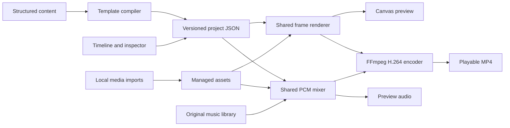

# Kuro Studio architecture

Kuro Studio is a local desktop application with an optional local browser interface. No account, hosted service, API key, content download, or network rendering is required after installation.

## Decisions

- **Electron + React + TypeScript:** a Windows-compatible desktop shell, isolated preload API for native output selection, and a responsive component UI. The same local app can be opened in a browser during development.
- **Shared Canvas 2D composition:** `src/core/render.ts` draws each frame from a serializable project and an explicit time. Preview uses the browser Canvas; export uses `@napi-rs/canvas`. Both call the same animation and layout code. Bundled DejaVu fonts remove an external font dependency. Different Canvas implementations can have small antialiasing differences.
- **FFmpeg and FFprobe:** deterministic frame-by-frame H.264/yuv420p encoding, AAC audio, media probing, video decoding, and local format interoperability. Bundled platform binaries support ordinary Windows installation; explicit environment paths can override them.
- **Original PCM music + shared audio mixer:** music is composed procedurally from authored note patterns. Narration and music are separate clips. Preview audio and exports use the same trimming, gain, fade, loop, normalization, and ducking calculations.
- **Versioned JSON + managed media:** projects are editable structured documents. Imports are copied into local application data. Saving uses validated data and atomic file replacement. Project deletion does not remove potentially shared assets.
- **UI-independent rendering:** the CLI loads the same schema and renderer without Electron, React, or an HTTP server.

## Flow

## Ownership and integration

See `docs/CONTRACTS.md` for module interfaces and `docs/ORCHESTRATION_REPORT.md` for actual agent assignments. The integration branch is `integration/anime-studio`; no default-branch merge or external publication is part of this work.

## Creative assumptions

Only the pasted text brief was supplied. No reference video was attached or available in the repository, so its composition or timing could not be analyzed. The visual direction is original: editorial typography, warm ivory/coral editor chrome, dark cinematic compositions, graphic character silhouettes, rank numerals, restrained camera movement, and clear text hierarchy. No commercial anime footage or music is downloaded.

## Operational boundaries

The HTTP server binds to loopback. Media routes resolve registered asset IDs instead of accepting arbitrary filesystem paths. The Electron renderer has Node integration disabled and context isolation enabled. Native export destinations originate from a save dialog. CLI users explicitly provide local input/output paths.

Full-length audio is mixed into memory; memory use grows with duration. Video frames are decoded as needed rather than retaining an entire movie. This application targets short and medium narrated template videos, not multihour feature-film editing.
