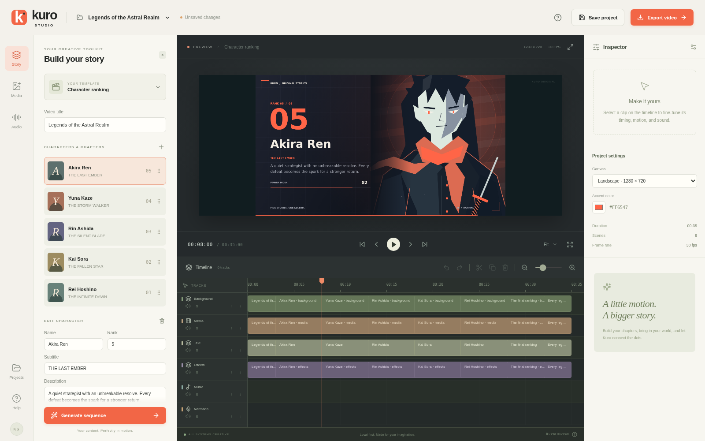

# Kuro Studio · Anime Video Editor

A local, template-driven video editor for rankings, character studies, and comparisons. Build a structured story, import your own images/video, adjust six timeline tracks, replace narration independently of music, and export an actual H.264/AAC MP4. Rendering also works from the command line without the UI.



## Launch

**Windows 10/11 x64:** run the supplied `Kuro Studio 1.0.0.exe` portable application. It includes the UI, four original music tracks, fonts, FFmpeg/FFprobe, and Windows canvas rendering library. No Node installation or cloud account is needed to use the packaged app. The executable is unsigned. Its package has been built and statically inspected on Linux; Windows runtime acceptance remains unverified. See [Windows build and acceptance](docs/WINDOWS_BUILD.md).

**From source** (Node.js 22 or newer):

```sh
npm ci
npm run build
npm run desktop
```

For a local browser interface:

```sh
npm run build
npm run start:production
```

Open `http://127.0.0.1:4310`. For development, `npm run dev` starts the editor on `http://127.0.0.1:5173` and API on port 4310. First installation/build needs network access; editing, music, preview, and export operate locally afterwards. On managed proxy environments, Electron's installer may need `ELECTRON_GET_USE_PROXY=1` with the inherited proxy configuration.

## Make a narrated ranking

1. Open **Projects**, choose **Character ranking**, name the project, and create it. The five initial characters and illustrations are original examples.
2. Edit each entry's name, rank, subtitle, description, and quote. Use **+** for more entries or remove entries as needed.
3. Drop PNG/JPEG/WebP images or MP4/WebM videos into the editor, or use **Media → Import**. Select each character's image/video, or use the library's assignment action.
4. Choose **Generate sequence**. This rebuilds the four visual tracks from structured content while preserving narration and music. Manual visual timing/effect edits are replaced by generation; save or duplicate a project before trying a different structure.
5. Play the preview. Select a timeline clip to change its start, duration, source trim, motion, opacity, or crop. Drag clips to move; drag their edges to trim. Use the ruler to seek, zoom controls for detail, and track mute/solo/order controls.
6. Open **Audio** and choose one of four original loops, or import your own audio. Use **Import narration** to place a recording at the playhead. The selected narration clip exposes volume, normalization, fades, trim, and looping.
7. Enable **Automatic ducking** and adjust strength, attack, and release. Detection uses actual narration amplitude, so silent parts of a recording do not continuously duck the music. Normalization is peak normalization, not broadcast LUFS mastering.
8. **Save project**, then reopen it from **Projects**. Imports are copied to managed local storage, so moving the original source file does not break the saved project.
9. **Export video**, choose 720p, 1080p, or portrait, select the audio mode and quality, then export. The desktop app opens a native output-location dialog; browser mode provides a download. Export progress, cancellation, and failures are visible.
10. Export again with **Music only** to omit narration without changing visual timing. **Narration only** and **Silent video** are also available. Duplicate the project and replace media/content for another episode.

Project edits pause playback so an old audio mix cannot continue against an edited timeline. Press Play to prepare the updated mix. Imported video is a visual source; to use its audio, add that asset to a music or narration track programmatically. The main narration importer accepts audio files.

## Original music

| Track            | Mood                       | BPM |
| ---------------- | -------------------------- | --: |
| Paper Lanterns   | Curious and playful        | 112 |
| Midnight Archive | Mysterious and atmospheric |  78 |
| Rival Circuit    | Energetic and competitive  | 132 |
| After the Rain   | Emotional and cinematic    |  84 |

All four are original deterministic synthesized compositions with no external samples or paid generation service. They are intentionally restrained underscores. Their waveforms, origin, and CC0 dedication are in [the music license](public/music/LICENSE.md). Regenerate with `npm run music`.

## Rendering without the editor

```sh
npm run render -- --create ranking --output project.json
npm run render -- --project project.json --output video.mp4
npm run render -- --project project.json --output music-only.mp4 --audio music
npm run render -- --project project.json --output quick-check.mp4 --duration 3
```

Templates are `ranking`, `analysis`, and `comparison`. Relative asset paths resolve beside the project JSON. Use `--width 1080 --height 1920` for a responsive portrait composition. The normal project frame rate is 30 FPS. `node dist/cli.cjs --help` works after building and does not start Electron or the local API. `FFMPEG_PATH` and `FFPROBE_PATH` override bundled binaries.

Programmatic code uses `createProject`, `generateSequence`, `validateProject`, and `renderProject`; see [template customization](TEMPLATES.md) and [architecture](ARCHITECTURE.md). JSON schema version is currently `1`. Unsupported versions and invalid references are rejected with an error; no historical schema migration is needed yet.

## Local data and backups

Desktop data is under Electron's user data directory, in `studio/` (normally `%APPDATA%/Kuro Studio/studio` on Windows). The local browser server uses `%APPDATA%/Kuro Studio` on Windows or `$XDG_DATA_HOME/Kuro Studio` / `~/.local/share/Kuro Studio` on Linux. Set `ANIME_STUDIO_DATA` for the standalone server to choose a directory. Back up the entire directory, including `projects/` and `assets/`; project JSON alone is not a portable media bundle. The desktop native save dialog chooses the MP4 destination independently.

## Development and verification

```sh
npm run typecheck
npm test
npm run test:e2e
npm run package:win
```

The E2E test runs the production browser build on a dedicated loopback port. On Linux it uses `/usr/bin/chromium`; set `PLAYWRIGHT_CHROMIUM_EXECUTABLE` to override, or install a Playwright browser on other systems. A sandbox must permit loopback listeners and subprocesses for API/browser tests.

See [actual verification and limitations](TESTING.md), [feature inventory](FEATURES.md), [delivery plan](GAMEPLAN.md), and [orchestration report](docs/ORCHESTRATION_REPORT.md). No reference video was supplied, so the visual baseline is original rather than a claimed analysis of an unavailable attachment. No anime footage was downloaded, and nothing is deployed or published externally.
